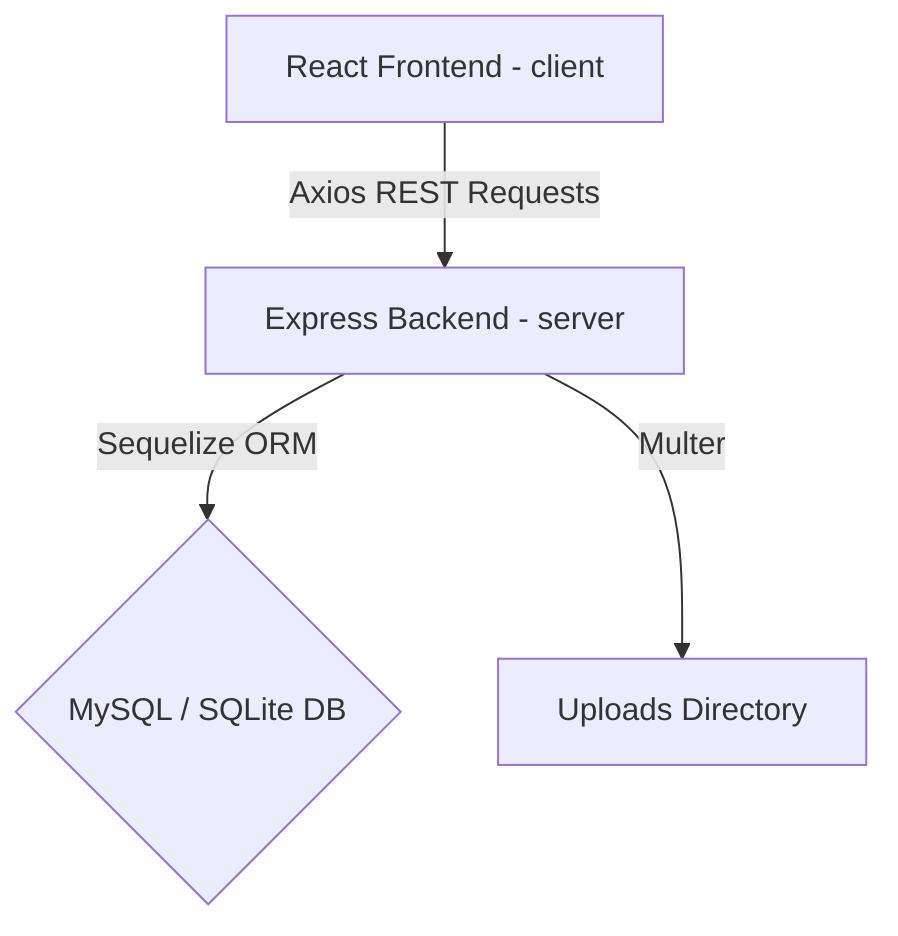
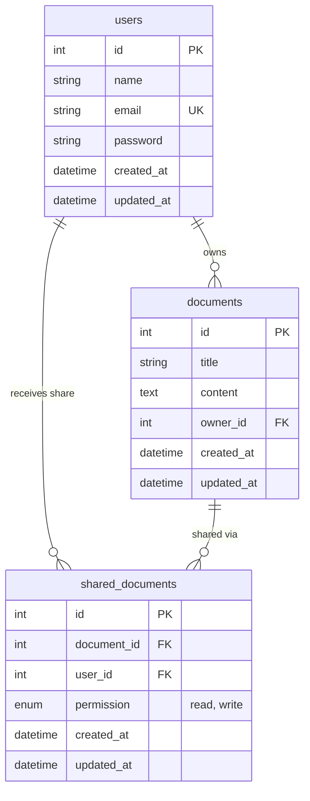

# CollabDoc - Application Architecture Documentation

This document explains the architectural decisions, database models, file storage strategies, security considerations, and trade-offs made in the implementation of the **Collaborative Document Editor (CollabDoc)**.

---

## 1. Application Architecture

CollabDoc follows a classic decoupled client-server architecture:



* **Frontend**: React client initialized via Vite, managing page routing with React Router DOM. API requests are routed via a central Axios helper that appends JWT credentials from localStorage.
* **Backend**: Express.js REST API. Authenticated requests are processed through JWT middleware which reads headers and injects user contextual data onto requests.
* **ORM & Database**: Sequelize handles relational modeling. By using Sequelize, the application dynamically resolves database targets—falling back to SQLite if MySQL fails—without changing application queries.

---

## 2. Database Design



* **Foreign Keys & Cascades**:
  * `documents.owner_id` references `users.id` with default key behaviors.
  * `shared_documents.document_id` references `documents.id` with `ON DELETE CASCADE`. If an owner deletes their document, all collaborator permissions are deleted automatically.
  * `shared_documents.user_id` references `users.id` with default key behaviors.

---

## 3. API Design

All endpoints are prefixed with `/api` and return JSON responses.

### Authentication Endpoints
* `POST /api/auth/login`: Validates inputs, compares bcrypt hashes, and returns a 24h JWT token.
* `GET /api/auth/me`: Decodes user context from token header and returns active profile details. *(Protected)*

### Document CRUD & Share Endpoints
* `GET /api/documents`: Returns lists of owned documents and shared documents. *(Protected)*
* `GET /api/documents/:id`: Returns single document details. If the user has no owned or shared access, returns 403 Forbidden. *(Protected)*
* `POST /api/documents`: Creates a new document. Supports importing from files. *(Protected)*
* `PUT /api/documents/:id`: Updates title/content. Requires owner permission or shared `'write'` editor status; otherwise returns 403. *(Protected)*
* `DELETE /api/documents/:id`: Deletes document. Requires owner permissions; otherwise returns 403. *(Protected)*
* `POST /api/share`: Shares document. Resolves recipient by email, validates that they are not the owner, and creates/updates a shared permission record. Requires owner status; otherwise returns 403. *(Protected)*

---

## 4. Authentication Flow

```
User Input Email/PW -> POST /login -> Match Hash -> Sign JWT -> Return Token
                                                                   |
Dashboard Page Mount -> Fetch /auth/me <- Inject header Bearer <- Save LocalStorage
```

---

## 5. Document Storage Strategy

* **Format**: Document bodies are saved as formatted **HTML** strings. This aligns with TipTap's native rendering capabilities, making loading and displaying content fast and accurate.
* **Import File Logic**:
  * Multer handles the upload.
  * Backend checks the file extension. If valid, reads the file as UTF-8 string.
  * Creates a new document in the database with the content populated and deletes the temporary file.

---

## 6. Architectural Trade-offs & Decisions

### SQL Fallback Mechanism
* **Decision**: Implement a database test helper which catches MySQL errors and falls back to SQLite.
* **Trade-off**: This adds slight initialization complexity but makes the codebase extremely resilient. It works instantly for reviewers with zero setup while remaining fully ready for standard production MySQL servers.

### Polling Auto-Save vs. Debouncing
* **Decision**: Run a 5-second polling check which fires saves only if the document state is `'unsaved'`.
* **Trade-off**: While debounce triggers database calls on typing pauses, a heartbeat interval limits maximum requests during continuous typing and guarantees the client doesn't flood the server with requests.

### Client-side state vs. Real-time CRDT
* **Decision**: Save complete HTML contents instead of differential change-logs.
* **Trade-off**: It is much simpler to implement and highly robust for single-editor and shared-access flows. However, for concurrent multi-user editing, a CRDT/Yjs operational transformation model would be needed to prevent edits from overwriting each other.
